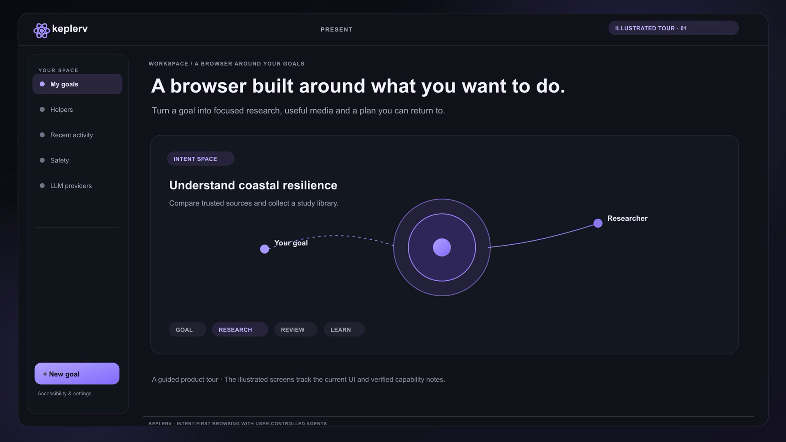
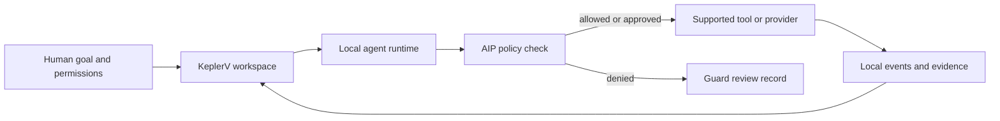

# KeplerV

**The browser that works toward your goals.**

Your intent. Your agents. Your rules.

KeplerV is a macOS browser prototype for goal-based work with AI agents. Give an agent a research goal, review its findings and evidence, and keep control of what it can do. KeplerV routes supported agent actions through AIP, its permission layer, and records selected risks and decisions in Guard for human review.

[](output/judge-demo/keplerv-judge-demo.mp4)

*This narrated tour is an illustration built from the current interface and capability notes, not a screen recording. It does not claim a live model run or external action. [Read the tour notes and source examples](output/judge-demo/README.md).*

> **Prototype status:** KeplerV is under active development. Live integrations, experimental capabilities, and fictional fixtures are called out in the [capability notes](#what-works-today). There is no signed public download yet; use the developer setup below to run it from source.

## What you can do

- **Work from goals:** organize research around an outcome instead of managing a pile of tabs.
- **Review agent research:** inspect findings, source excerpts, and activity attached to a goal.
- **Set action boundaries:** AIP checks supported tool requests against the agent, goal, capability, origin, and approval rules before execution.
- **Inspect selected risks:** Guard keeps a reviewable record of policy denials and selected risk signals. Its model-based assessments are advisory and do not grant access.

KeplerV does not claim to detect every attack or make every integration production-ready. Phase 6 federation and merchant scenarios include experimental behavior and fictional fixtures.

## Try KeplerV from source

KeplerV currently runs as a macOS desktop app. A signed, notarized public installer is not available yet.

### Requirements

- macOS
- Xcode Command Line Tools
- Node.js 20.19+ or 22.12+
- Rust stable
- Python 3.12

### Install and launch

From the `browser/` directory in this repository:

```sh
npm ci
python3.12 -m venv .venv
.venv/bin/python -m pip install -r runtime/requirements.txt
.venv/bin/python -m playwright install chromium
npm run desktop
```

The first launch opens the Tauri desktop app and starts its local Python runtime. Connect a model in **LLM providers** to run live research. Alternatively, set `MODEL_API_KEY` in the shell before starting KeplerV. See [.env.example](.env.example) for supported variable names; it is a template and is not loaded automatically.

`npm run dev` starts only the web interface. Runtime and native features require `npm run desktop`.

## What works today

| Area | Status |
| --- | --- |
| Desktop app and goal workspace | Native Tauri 2 + Svelte app; macOS development launch is supported |
| Research runtime | Local Python service with agent lifecycle, public-web search, isolated Playwright browsing, and local event/evidence storage |
| AIP | Deterministic authorization for supported tools; experimental and not a production security protocol |
| Guard | Review records for policy denials and selected risk signals; model-based reviews are advisory |
| Connected services | Provider and OAuth integrations vary by provider; see [mail and OAuth setup](docs/mail-setup.md) |
| Federation and merchant flows | Experimental; some scenarios use fictional fixtures. See [Phase 6 status](docs/phase6-federation.md) |

For the detailed real-versus-fixture breakdown, see [Phase 5 capabilities](docs/phase5-capabilities.md), [Phase 6 federation and capability status](docs/phase6-federation.md), and [Phase 6 Trust Gateway](docs/phase6-trust-gateway.md).

## How it works



The Svelte interface talks to a Tauri/Rust desktop shell, which manages a local Python runtime. The runtime routes supported agent actions through AIP and stores workspace events and evidence locally. See the [architecture and contributor guide](CONTRIBUTING.md#how-the-pieces-fit-together) for details.

## Build and verify

```sh
npm test                                      # Svelte/TypeScript tests
npm run test:runtime                          # Python runtime tests
npm run test:browser                          # Live Playwright browser integration test
npm run build                                 # Frontend type checks and production build
cargo test --manifest-path src-tauri/Cargo.toml
```

The browser integration test uses the network. Live model calls require a provider credential and may incur provider usage. See [CONTRIBUTING.md](CONTRIBUTING.md) and the phase documents for focused checks and limitations.

## Build a macOS installer

The release script builds a bundled Python runtime and Playwright Chromium, signs the app when a Developer ID identity is configured, and creates a drag-to-Applications DMG. The result is architecture-specific and large because Chromium and the Python runtime are included.

```sh
export APPLE_SIGNING_IDENTITY='Developer ID Application: Your Name (TEAMID)'
npm run desktop:build
```

The DMG is written to `src-tauri/target/release/bundle/dmg/`. For an unsigned local build, leave `APPLE_SIGNING_IDENTITY` unset. Distribution outside your own Mac requires signing and notarization; see [the full macOS installer guide](CONTRIBUTING.md#build-and-notarize-a-macos-dmg). Mac App Store packaging is a separate release track; see [App Store readiness](docs/app-store-readiness.md).

## Contributing

Contributions are welcome. Start with [CONTRIBUTING.md](CONTRIBUTING.md) for the source map, development workflow, design rules, and macOS packaging steps. When proposing changes, clearly label live behavior, experimental features, and fixture-backed demos.

## Security and privacy

Read the [Guard architecture](docs/guard-architecture.md) and [privacy and data controls](docs/privacy-and-data-controls.md). The project does not yet publish a dedicated security reporting policy.

## License

No license file is currently published. Until a license is added, do not assume the code is licensed for reuse. See the repository owner before redistributing or building on it.

## Project notes

- [Phase 5 capabilities](docs/phase5-capabilities.md)
- [Phase 6 federation and capability status](docs/phase6-federation.md)
- [Phase 6 Trust Gateway](docs/phase6-trust-gateway.md)
- [Phase 6 evaluation](docs/phase6-eval.md)
- [Mail and OAuth setup](docs/mail-setup.md)
